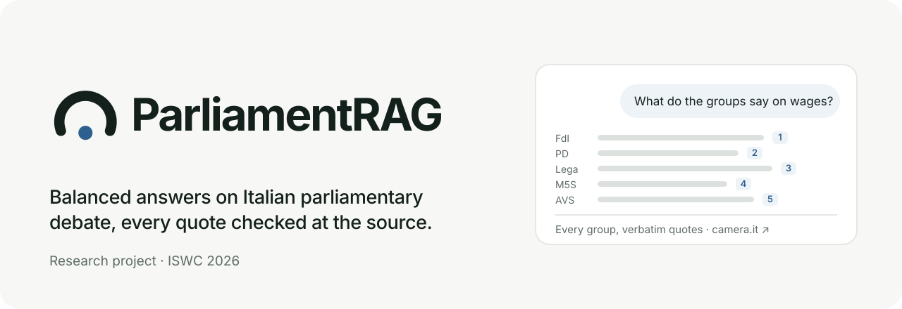

<div align="center">

<picture>
  <source media="(prefers-color-scheme: dark)" srcset="assets/banner-dark.svg">
  
</picture>

<br>

**Balanced, verifiable answers about Italian parliamentary debate, grounded in what was actually said and by whom.**

<br>

<a href="https://truthful-amazement-production.up.railway.app"></a>
<a href="https://www.parliamentrag.it/"></a>
<a href="https://iswc2026.semanticweb.org"></a>
<a href="https://doi.org/10.5281/zenodo.21560331"></a>
<a href="https://huggingface.co/datasets/emeierkeio/parliamentrag-camera-leg19"></a>
<a href="LICENSE"></a>
<a href="https://creativecommons.org/licenses/by-sa/4.0/"></a>

<br>

<!-- famiglia:start (keep identical across repos) -->
<table align="center">
  <tr>
    <td align="center" valign="bottom" width="160">
      <a href="https://www.parliamentrag.it">
        <picture>
          <source media="(prefers-color-scheme: dark)" srcset="assets/famiglia/parliamentrag-dark.svg">
          
        </picture>
        <br><b>ParliamentRAG</b>
      </a>
      <br><sub>parliamentrag.it</sub>
    </td>
    <td align="center" valign="bottom" width="160">
      <a href="https://www.stenografo.it">
        <picture>
          <source media="(prefers-color-scheme: dark)" srcset="assets/famiglia/stenografo-dark.svg">
          
        </picture>
        <br><b>Stenografo</b>
      </a>
      <br><sub>stenografo.it</sub>
    </td>
    <td align="center" valign="bottom" width="160">
      <a href="https://www.fascicoli.it">
        <picture>
          <source media="(prefers-color-scheme: dark)" srcset="assets/famiglia/fascicoli-dark.svg">
          
        </picture>
        <br><b>Fascicoli</b>
      </a>
      <br><sub>fascicoli.it</sub>
    </td>
    <td align="center" valign="bottom" width="160">
      <a href="https://www.scranno.it">
        <picture>
          <source media="(prefers-color-scheme: dark)" srcset="assets/famiglia/scranno-dark.svg">
          
        </picture>
        <br><b>Scranno</b>
      </a>
      <br><sub>scranno.it</sub>
    </td>
  </tr>
</table>
<!-- famiglia:end -->

</div>

<br>

This repository holds the ParliamentRAG system presented at ISWC 2026: an authority-aware, multi-view Retrieval-Augmented Generation system over the stenographic records of the Camera dei Deputati (XIX Legislature). You ask a policy question and get an answer that covers majority and opposition groups, with quotes checked against the official transcripts.

The system gives three guarantees:

1. **All groups.** Retrieval and generation consider every parliamentary group. When a group has no relevant evidence, the pipeline marks it as absent instead of dropping it in silence.
2. **Authoritative voices.** For each group, the system picks the deputies most authoritative on that topic, according to criteria documented below and in the paper.
3. **Exact quotes.** The pipeline re-extracts every quotation from the source transcript and checks it verbatim; it drops any quote that fails the check. Each citation links to the official debate.

Corpus as of 2026-10-05: 719 plenary sessions, 47.6k speeches, 177k+ text chunks, 36.7k acts, 17.5k roll-call votes with 7M individual vote records.

---

## Where to find what

| You are looking for | Where it is |
|---|---|
| The system as demonstrated at ISWC 2026 | Public demo at [truthful-amazement-production.up.railway.app](https://truthful-amazement-production.up.railway.app); code frozen in tag [`iswc2026-demo`](https://github.com/Emeierkeio/ParliamentRAG/tree/iswc2026-demo) |
| The code and configuration behind the paper's evaluation | Tag [`iswc2026-eval`](https://github.com/Emeierkeio/ParliamentRAG/tree/iswc2026-eval) (GPT-4o generation models; the tag message lists the exact weights) |
| The research centre: publications, method, open data | [parliamentrag.it](https://www.parliamentrag.it) |
| The dataset | Zenodo, DOI [10.5281/zenodo.21560331](https://doi.org/10.5281/zenodo.21560331); Hugging Face, [emeierkeio/parliamentrag-camera-leg19](https://huggingface.co/datasets/emeierkeio/parliamentrag-camera-leg19) |
| How to cite | [Citation](#citation) and [`CITATION.cff`](CITATION.cff) |
| A version for the general public | [Fascicoli](https://www.fascicoli.it), see below |

Since 5 October 2026, www.parliamentrag.it hosts the research centre and no longer runs the chat. The old application pages of the site (`/home`, `/search`, `/ranking`, `/compass`, `/timeline`, `/parlamentari`) redirect to Fascicoli.

---

## Systems

ParliamentRAG is a research centre of the University of Milano-Bicocca (Mirko Tritella, Riccardo Pozzi, Matteo Palmonari). The system in this repository was presented at ISWC 2026 in the In-Use Track and at Posters & Demos. The same knowledge graph serves three public systems, in Italian:

| System | What it does |
|---|---|
| [Fascicoli](https://www.fascicoli.it) | One topic, every group. Dossiers that compare the positions of the parliamentary groups, with verified quotes, authoritative voices on the topic and a map of positions. Fascicoli started as a fork of this repository's chat and is its successor for the public. |
| [Stenografo](https://www.stenografo.it) | Precise answers about the Chamber's facts (votes, acts, sittings, speeches, deputies, procedure), each sentence with its official source. Questions about party positions go to Fascicoli. |
| [Scranno](https://www.scranno.it) | A visual exploration of the Montecitorio chamber: seats and votes. |

---

## Why

LLM summaries of parliamentary activity tend to favour dominant actors, quote out of context and flatten disagreement. ParliamentRAG gives the speaker as much weight as the text: retrieval, generation and presentation cover the whole range of parliamentary groups, and every claim points to a span of the official record you can check.

---

## System architecture

<p align="center"></p>

### Query pipeline

Each question runs through one streamed pipeline; the frontend shows its progress as an 8-step stepper.

<p align="center"></p>

1. **Query analysis**: the backend classifies the question and, if it is short or ambiguous, rewrites it for retrieval.
2. **Committee matching**: the query is mapped to the relevant parliamentary committees.
3. **Expert selection**: for each parliamentary group, the backend picks the top speaker by a **query-specific authority score** with six components: profession, education, committee membership, legislative acts, speech interventions, institutional role. Semantic components use the query embedding; activity components decay over time (half-life 18 months).
4. **Multi-view retrieval**: a dense channel (vector similarity over `text-embedding-3-small` embeddings) and a graph channel (lexical and semantic EuroVoc matching to acts, then the speeches of their signatories) feed a weighted merger that balances relevance, party coverage, speaker diversity and political salience.
5. **Balance metrics**: coverage and balance statistics over the retrieved evidence.
6. **Ideological compass**: the backend places the parliamentary groups on two axes anchored to the question. An LLM generates the opposing poles of each axis per query (for example "more public spending" vs. "budget rigour") and scores each speaker's stance on them; if that call fails, the compass falls back to embedding projection.
7. **Generation**: an analyst decomposes the evidence into claims, a sectional writer drafts one section per group, and a deterministic assembler joins the sections so that citation markers survive. A quote picker chooses quotes from a fixed set of verbatim candidates.
8. **Citation verification**: every quotation is matched verbatim against its source speech and scored for coherence with the sentence around it; anything that fails is stripped from the answer.

### Models (current `main`)

| Role | Model |
|---|---|
| Writer and integrator | `gpt-4.1` |
| Analyst (claim decomposition) | `gpt-4.1-mini` |
| Quote picker | `gpt-5.6-luna` |
| Query rewriter, compass poles and stance scoring | `gpt-5.6-luna` |
| Translations of recaps and UI content | `gpt-5.6-luna` |
| Embeddings | `text-embedding-3-small` (1536-d, Neo4j native vector index) |

The paper's evaluation used GPT-4o for generation: see tag `iswc2026-eval`.

---

## Features

The demo exposes these pages:

| Page | What it does |
|---|---|
| `/` | Landing page |
| `/home` (chat) | Ask questions; streamed 8-step progress, per-party sections, **verified citation cards** with the full stenographic text in a modal, **expert cards** with the authority-score breakdown, inline ideological compass |
| `/search` | Search acts and records; filter by deputy or group, or browse an author's full record without a query |
| `/parlamentari` | Deputy directory and profiles: group history with periods, committees and offices, floor activity, recent speeches |
| `/gruppi` | Parliamentary groups with official logos, membership counts and member lists |
| `/ranking` | Topic-dependent authority rankings of deputies |
| `/compass` | Standalone ideological compass for any topic |
| `/timeline` | **Lavori d'Aula**: sessions, debates, phases and speakers, with AI-generated IT/EN recaps, per-speaker position summaries and roll-call detail (per-group breakdown and individual votes) |
| `/method` | How the authority score works, with its weights |
| `/explorer` | Interactive knowledge-graph exploration |
| `/data` | Open-data page: live graph statistics, ontology alignment, RDF dumps |
| `/valutazione` | Evaluation dashboard: automated metrics and blind A/B comparison with a baseline (needs an admin key) |

**UI**: editorial newspaper-style design (Fraunces serif), light and dark themes, mobile bottom navigation, and translations in 6 languages (`frontend/messages/{it,en,fr,de,es,pt}.json` via `next-intl`).

---

## Knowledge graph

We build the graph (schema v2) from **official open data**: stenographic XML reports (Akoma Ntoso) and the SPARQL endpoints of [dati.camera.it](https://dati.camera.it/) (deputies, groups, committees, acts, roles, votes), with EuroVoc subject links for parliamentary acts.

- **XIX Legislature, data as of 2026-10-05**, updated incrementally: 719 sessions, 47.6k speeches, 177k+ chunks, 36.7k acts, 17.5k roll calls with 7M individual votes
- **Speaker model**: every speaker is a `Person` (labels `Deputy` / `GovernmentMember`) with date-aware group membership; deputies in the Gruppo Misto are attributed to their political component
- **Native types**: embeddings as float arrays in Neo4j vector indexes, dates as `date()` values; every `Chunk` is an exact substring of its `Speech` (a verified invariant)
- **Linked Data**: entity URIs follow the source datasets (dati.camera.it/ocd/…, eurovoc.europa.eu/…); project terms use the [w3id.org/parliamentrag](https://w3id.org/parliamentrag/) namespace
- Every build and update ends with an **invariant validation gate** (`build/validate_db.py`): string embeddings, orphan speeches, broken chunk offsets or malformed URIs fail the build
- **RDF export**: `make export-rdf` serializes the graph back to RDF (Turtle, plus the individual votes in N-Triples); the dump is archived on Zenodo under CC BY-SA 4.0 with DOI [10.5281/zenodo.21560331](https://doi.org/10.5281/zenodo.21560331)
- **Hugging Face dataset**: the same corpus in tabular form, [emeierkeio/parliamentrag-camera-leg19](https://huggingface.co/datasets/emeierkeio/parliamentrag-camera-leg19) (CC BY-SA 4.0), produced with `make export-hf`

The construction pipeline lives in [`build/`](build/README.md). Against the local Neo4j of `docker-compose.yml`:

```bash
make db-populate        # full build from scratch
make db-update          # incremental: new sessions and acts
```

<p align="center"></p>

<p align="center"></p>

---

## Quickstart

**Prerequisites**: Python 3.12, Node.js 20+, Docker (for a local Neo4j), an OpenAI API key, and a populated Neo4j database (see [Knowledge graph](#knowledge-graph)).

```bash
# 1. Configure the environment
cp .env.example .env   # set OPENAI_API_KEY and NEO4J_PASSWORD; NEO4J_URI defaults to the local bolt://localhost:7689

# 2. Start the local Neo4j
docker compose up -d neo4j

# 3. Install backend (venv) and frontend dependencies
make install

# 4. Run backend (:8000) and frontend (:3000), each in its own terminal
make dev-backend
make dev-frontend
```

Override the ports with `BACKEND_PORT=8001 FRONTEND_PORT=3001`. `make stop` frees them and `make build` produces the production build of the frontend.

`make dev` starts both sides at once, but it first opens an SSH tunnel to the maintainers' database, as do `make update-data`, `make db-backup`, `make db-pull` and `make browser`. Those targets only work with access to that server.

The interactive API docs (`/docs`), the evaluation routes and the chat history listing are admin-only. To open them, export `API_KEYS=<name>:admin:<secret>` in the shell that runs the backend (the backend reads it from the process environment, not from `.env`) and send the secret in the `X-API-Key` header. Without an admin key the backend refuses those routes.

---

## Configuration

### Environment (`.env`)

| Variable | Description |
|---|---|
| `NEO4J_URI` | Bolt connection URI |
| `NEO4J_USER` / `NEO4J_PASSWORD` | Neo4j credentials |
| `OPENAI_API_KEY` | One key, or a comma-separated list to spread rate limits |
| `LANGSMITH_API_KEY` | Optional tracing of LLM calls; empty disables it |
| `LOG_LEVEL` | `DEBUG` / `INFO` / `WARNING` / `ERROR` |
| `NEXT_PUBLIC_API_URL` | Backend API URL as seen from the browser |

`API_KEYS` (comma-separated `name:scope:secret` entries) goes in the process environment: see [Quickstart](#quickstart).

### Algorithmic parameters (`backend/config/default.yaml`)

| Section | Controls |
|---|---|
| `retrieval.dense_channel` / `retrieval.graph_channel` | top-k, similarity thresholds, lexical matching |
| `retrieval.merger` | fusion weights: relevance 0.35, salience 0.25, coverage 0.20, diversity 0.15, authority 0.05 |
| `authority.weights` | interventions 0.25, committee 0.25, acts 0.20, profession 0.15, education 0.10, role 0.05 |
| `authority.time_decay` | half-life for acts and speeches |
| `compass` | axis method, pole and stance models |
| `generation.models` | per-stage model selection |
| `query_rewriting` | short-query expansion (model, word threshold) |
| `coalitions` | majority and opposition group lists |

`backend/config/commissioni_topics.yaml` maps committee names to topic areas for committee-based filtering.

---

## API overview

All routes live under `/api`.

| Endpoint | Description |
|---|---|
| `POST /api/chat` | Streaming query pipeline (SSE events include `progress`, `experts`, `citations`, `compass`, `chunk`, `complete`) |
| `GET /api/chat/task/{task_id}` | Reconnect to a running pipeline task |
| `GET /api/evidence/{id}` | Full evidence item with source transcript |
| `GET /api/search/results` | Search over acts and records |
| `POST /api/authority-ranking` | Topic-dependent authority rankings |
| `POST /api/compass` | Standalone ideological compass |
| `GET /api/timeline` | Sessions, debates, phases, votes, speaker summaries |
| `GET /api/data/stats` | Live graph statistics |
| `GET /api/graph/schema` | Knowledge-graph schema for the explorer |
| `GET /api/evaluation/dashboard` | Automated metrics and A/B results (admin) |
| `POST /api/surveys` | Submit an A/B evaluation |

---

## MCP connector (Claude, ChatGPT and compatible clients)

ParliamentRAG also runs as a [Model Context Protocol](https://modelcontextprotocol.io) server. Assistants get read-only access to the official records: hybrid search over speeches and acts, sittings with recaps, roll-call votes with per-deputy outcomes (filterable by deputy or group), the exact text of voted amendments, and hemicycle charts rendered as images in the conversation.

**Hosted endpoint (claude.ai, ChatGPT and any remote-MCP client):** add it to your assistant's connectors:

```
https://mcp.parliamentrag.it/mcp
```

**Local (Claude Code, Cursor, VS Code, Gemini CLI):** the server reads the public API from `PARLIAMENTRAG_API`. Its default, `https://www.parliamentrag.it/api`, no longer answers since the site became the research centre, so point it at the demo:

```bash
claude mcp add parliamentrag -e PARLIAMENTRAG_API=https://truthful-amazement-production.up.railway.app/api -- uv run /path/to/ParliamentRAG/mcp/server.py
```

Ask things like *"come hanno votato i deputati del PD sul voto finale del DDL 2961?"* or *"mostrami l'emiciclo di quel voto"*, and the answer comes from the official records instead of model memory. Setup for every client: [`mcp/README.md`](mcp/README.md).

---

## Evaluation

The repository includes a two-level evaluation framework over 15 policy topics (`backend/evaluation_set.json`, with pre-computed query-specific baseline experts):

- **Automated metrics** (`/api/evaluation/dashboard`): parliamentary-group coverage, citation relevance and faithfulness, coalition balance and authority distribution, computed for the system and the baseline on the same topics.
- **Blind A/B protocol** (`/valutazione`): side-by-side comparison of system and baseline answers, rated on 9 dimensions on a 1–5 Likert scale, plus an overall preference and a satisfaction score.

The paper compares the system with Google NotebookLM on these 15 topics, rated by six domain experts. ParliamentRAG reached higher group coverage (0.97 vs. 0.95) and quotation faithfulness (1.00 vs. 0.95). The experts favoured it on source-related dimensions (Cohen's *d* = 0.35 on Source Relevance and Source Coverage), favoured NotebookLM on prose quality, and rated overall satisfaction as comparable. The paper tests the differences with Wilcoxon signed-rank tests and Holm–Bonferroni correction. To reproduce the setup, check out tag `iswc2026-eval`; details are in the paper (see [Citation](#citation)).

---

## Data attribution

Parliamentary data are sourced from the **Camera dei Deputati open data** program ([dati.camera.it](https://dati.camera.it/)), released under [CC BY-SA 4.0](https://creativecommons.org/licenses/by-sa/4.0/); the derived RDF and Hugging Face datasets keep the same license. The texts of stenographic reports are official acts of the Italian State and as such are not subject to copyright (art. 5, L. 633/1941). ParliamentRAG is an independent project and is not affiliated with or endorsed by the Camera dei Deputati.

---

## Repository layout

```
backend/    FastAPI app: retrieval, authority scoring, generation, citation verification
frontend/   Next.js app: chat, search, rankings, compass, timeline, evaluation
build/      knowledge-graph construction pipeline and validation gate (see build/README.md)
mcp/        MCP server over the public API (see mcp/README.md)
docs/       LLM prompt reference, code style, design notes
assets/     banner, family logos and the diagrams in this README
```

---

## Citation

If you use this system or build on this work, please cite the paper
([accepted manuscript](https://www.parliamentrag.it/who-speaks-matters-iswc2026.pdf)). [`CITATION.cff`](CITATION.cff) holds the same metadata, and GitHub's "Cite this repository" button reads it.

Accepted at the **In-Use Track of the 25th International Semantic Web Conference (ISWC 2026)**.

```bibtex
@inproceedings{tritella2026whospeaksmatters,
  author    = {Tritella, Mirko and Pozzi, Riccardo and Palmonari, Matteo},
  title     = {Who Speaks Matters: Authority-Aware Multi-View RAG over Italian Parliamentary Proceedings},
  booktitle = {The Semantic Web -- ISWC 2026},
  publisher = {Springer},
  year      = {2026},
  note      = {To appear}
}
```

A companion **demo paper** on the system was accepted at the ISWC 2026 Posters & Demos track; we will add its CEUR-WS citation here once the proceedings are out.

Cite the **RDF dataset** with its Zenodo DOI: [10.5281/zenodo.21560332](https://doi.org/10.5281/zenodo.21560332) (version used in the paper) or [10.5281/zenodo.21560331](https://doi.org/10.5281/zenodo.21560331) (always the latest version). The same data are also on Hugging Face in tabular form: [emeierkeio/parliamentrag-camera-leg19](https://huggingface.co/datasets/emeierkeio/parliamentrag-camera-leg19).

A machine-readable **semantic description** of the paper (approach, knowledge graph, evaluation, comparison with related systems) is available in the [Open Research Knowledge Graph](https://orkg.org/papers/R1909763).

---

## Acknowledgments

This work was supported by the **EU Horizon Europe** programme through grant
No. [101189771](https://doi.org/10.3030/101189771) ([**DataPACT**](https://datapact.eu/)).

---

## License

[Apache 2.0](LICENSE)
